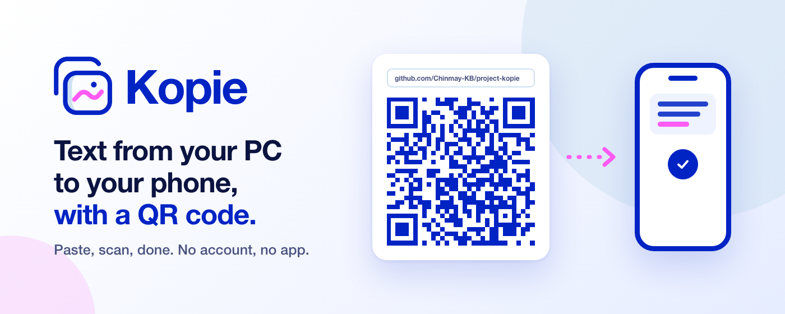
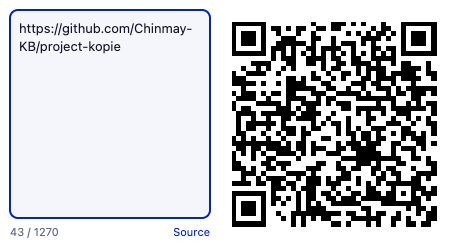

  

  <a href="https://microsoftedge.microsoft.com/addons/detail/kopie/llmgkefkiomomhcbnakdhpcaoadebhpl"><b>Get Kopie for Microsoft Edge</b></a>

# Kopie

A small browser extension that turns text into a QR code, so you can get it from your computer to your phone by pointing the camera at the screen.

Think of all the times you needed a long URL, a few lines of text or an activation code on your phone. Mailing it to yourself, or opening WhatsApp Web just to send yourself a message, works but is a chore. Kopie sits in your toolbar and does it in one click.

## How it works

1. Click the Kopie icon.
2. Paste or type your text.
3. Scan the QR code with your phone camera.

  

That is all. There is no account, no app on the phone and no server in between. The text never leaves your browser.

## Good to know

- **No permissions.** The extension does not ask for access to your tabs or the pages you visit.
- **Works offline.** The QR code is generated locally.
- **Any language.** Non-English text and emoji come through as they are.
- **Size limit.** A QR code can only hold so much before a phone camera stops reading it. Kopie takes up to 1270 bytes, which is about 1270 characters of English text and fewer for other scripts. The code grows with the text to stay readable.

## Install

**Microsoft Edge:** install it from the [Edge Add-ons store](https://microsoftedge.microsoft.com/addons/detail/kopie/llmgkefkiomomhcbnakdhpcaoadebhpl).

**Chrome and other Chromium browsers:** not on the Chrome Web Store yet ([#28](https://github.com/Chinmay-KB/project-kopie/issues/28)), so for now you load it by hand:

1. Clone this repository: `git clone https://github.com/Chinmay-KB/project-kopie.git`
2. Open `chrome://extensions` and turn on Developer mode.
3. Click "Load unpacked" and pick the `extension` folder.

**Firefox:** not supported yet ([#27](https://github.com/Chinmay-KB/project-kopie/issues/27)).

## Development

There is no build step. The extension is plain HTML and JavaScript in the `extension` folder, so you can edit a file and reload the extension to see the change.

A few things to know before sending a pull request:

- Any change under `extension/` has to bump `version` in `extension/manifest.json`. A check on the PR enforces this.
- Releases are cut by pushing a `v*` tag that matches the manifest version. That uploads the package to the Edge store.

See [CONTRIBUTING.md](CONTRIBUTING.md) for the rest, and the [open issues](https://github.com/Chinmay-KB/project-kopie/issues) for things that need doing.

## Contributors

<!-- ALL-CONTRIBUTORS-LIST:START - Do not remove or modify this section -->
<!-- prettier-ignore-start -->
<!-- markdownlint-disable -->
<table>
  <tr>
    <td align="center"><a href="https://github.com/Chinmay-KB"> <b>Chinmay Kabi</b></a> <a href="https://github.com/Chinmay-KB/project-kopie/commits?author=Chinmay-KB" title="Code">💻</a></td>
    <td align="center"><a href="https://connorruggles.dev"> <b>Connor Ruggles</b></a> <a href="https://github.com/Chinmay-KB/project-kopie/commits?author=rugglcon" title="Code">💻</a></td>
    <td align="center"><a href="https://okram.civokram.com/"> <b>Marko Marković</b></a> <a href="https://github.com/Chinmay-KB/project-kopie/commits?author=markomarkovic" title="Code">💻</a></td>
  </tr>
</table>

<!-- markdownlint-enable -->
<!-- prettier-ignore-end -->
<!-- ALL-CONTRIBUTORS-LIST:END -->

This project follows the [all-contributors](https://github.com/all-contributors/all-contributors) specification. Contributions of any kind are welcome.

## License

[MIT](LICENSE). Kopie is also [Starware](https://github.com/zepfietje/starware): if you use it and like it, a star on the repository is appreciated.
